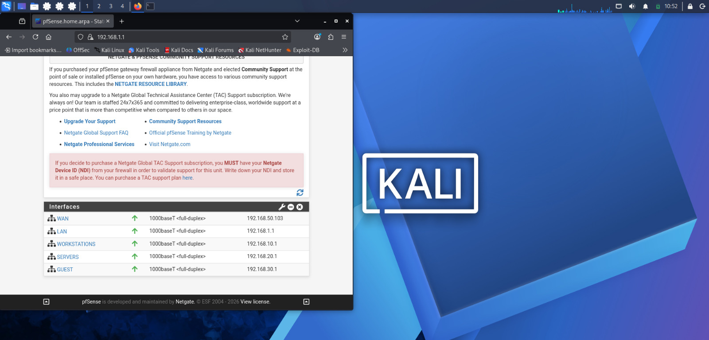
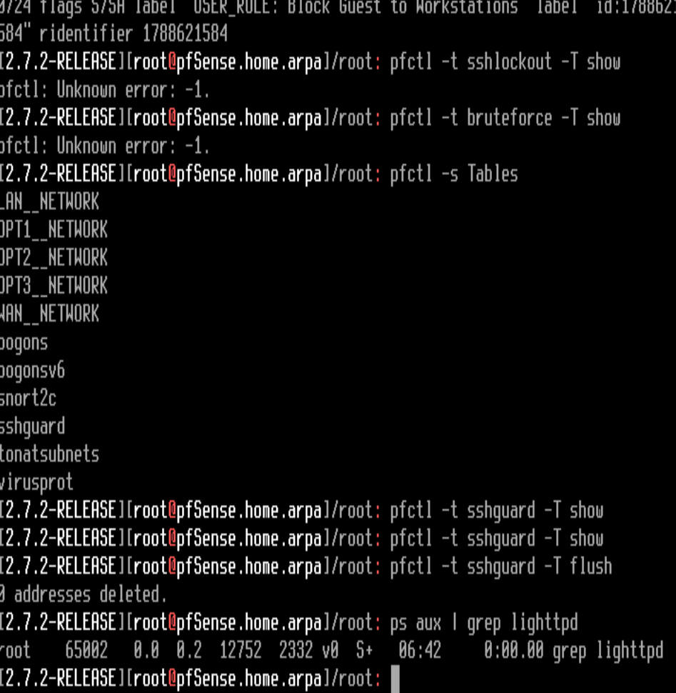
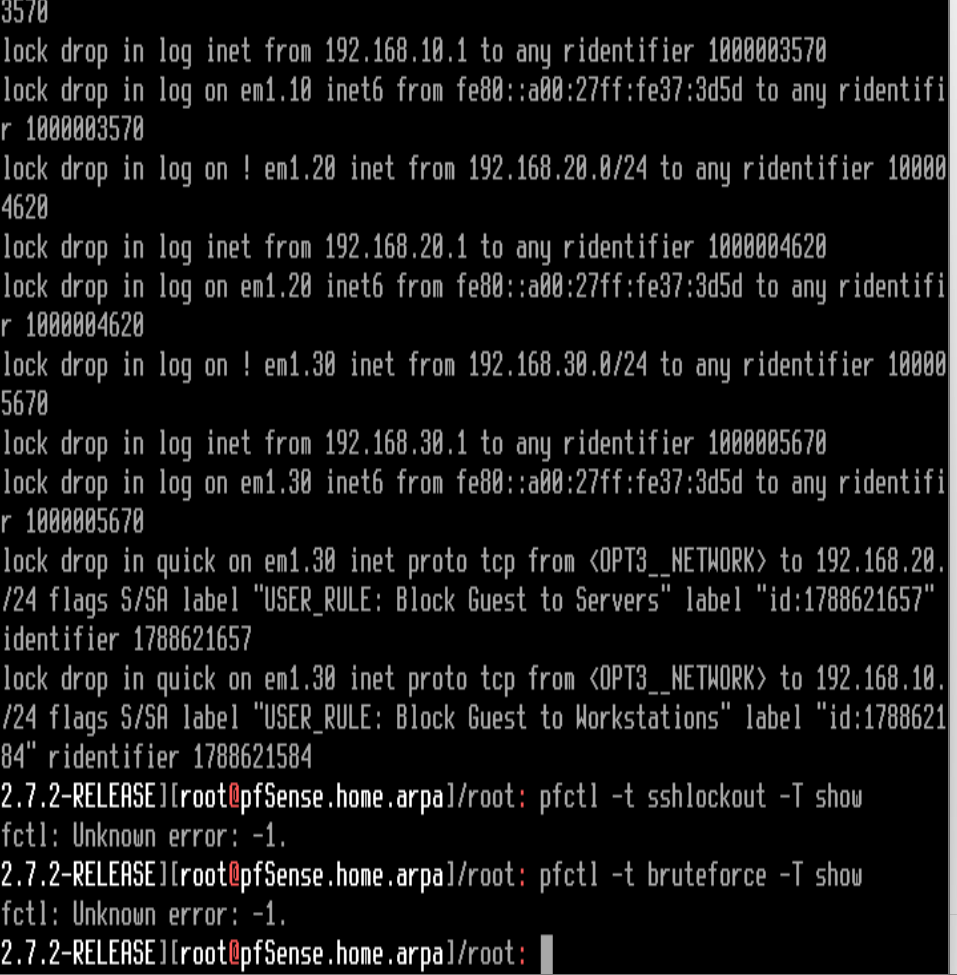
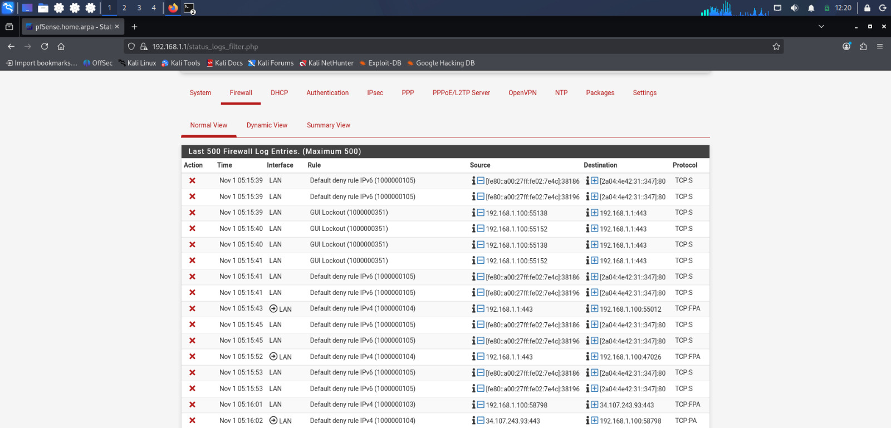

# pfSense Network Segmentation Lab

A home lab built with pfSense and VirtualBox to practice firewall rule design, VLAN-based network segmentation, and brute-force attack detection.

## Overview

This lab simulates a small segmented network behind a pfSense firewall, with isolated zones for workstations, servers, and guest devices. The goal was to practice real firewall administration: writing access rules between zones, verifying isolation, and testing the firewall's own defenses against a login brute-force attack.

## Tools used

- **pfSense CE 2.7.2** — firewall/router
- **Oracle VirtualBox** — virtualization
- **Kali Linux** — attack/test machine
- **Hydra** — brute-force testing tool

## Network layout

| Zone | Interface | Subnet | Role |
|---|---|---|---|
| WAN | em0 | 192.168.50.0/24 | Uplink to home router |
| LAN | em1 | 192.168.1.0/24 | Management network |
| WORKSTATIONS | em1.10 (VLAN 10) | 192.168.10.0/24 | Client devices |
| SERVERS | em1.20 (VLAN 20) | 192.168.20.0/24 | Internal services |
| GUEST | em1.30 (VLAN 30) | 192.168.30.0/24 | Untrusted/guest devices |

All three internal zones (WORKSTATIONS, SERVERS, GUEST) run as 802.1Q VLANs on a single physical interface (`em1`), each with its own pfSense interface, subnet, and firewall rule set.



## Firewall policy

| Rule | Effect |
|---|---|
| WORKSTATIONS → SERVERS, port 80 | Allowed |
| GUEST → SERVERS | Blocked (explicit rule) |
| GUEST → WORKSTATIONS | Blocked (explicit rule) |
| SERVERS → any | No rules defined (default deny; no outbound initiation) |
| Per-VLAN anti-spoofing | Each VLAN only accepts traffic genuinely sourced from its own subnet |

The GUEST zone is deliberately isolated from both internal zones, while still being able to reach the WAN. This mirrors a typical guest Wi-Fi design: internet access only, no access to internal resources.




## Brute-force detection test

To test pfSense's own login protection, I ran a brute-force attack from Kali against the pfSense web login using Hydra:

```
hydra -l admin -P /usr/share/wordlists/rockyou.txt 192.168.1.1 https-form-post \
  "/index.php:usernamefld=^USER^&passwordfld=^PASS^&login=Login:Invalid username or password" -V -t 4
```

**Result:**
- Approximately 26,900 login attempts were made against the admin account.
- No valid credentials were found.
- The pfSense **GUI Lockout** protection rule detected the repeated failed attempts and began blocking the attacking IP address (the Kali VM) from reaching the login page entirely.
- Under the sustained load, the pfSense web service (`lighttpd`) briefly became unresponsive and required a restart — a secondary finding about service resilience under attack, separate from the lockout mechanism itself.



## What I learned

- How to configure VLANs on a single physical interface and route between them through a central firewall.
- How to write explicit deny rules for zone isolation, and how rule order affects which rule actually takes effect.
- That a default-deny interface (SERVERS) blocks outbound connections by default, not just inbound.
- How pfSense's built-in GUI Lockout protection detects and blocks brute-force login attempts, visible directly in the firewall logs.
- That sustained attack traffic can affect service availability even when the attack itself fails, which is worth considering in real deployments.

## Possible next steps

- Add outbound-only internet access for the SERVERS zone.
- Forward pfSense firewall logs to [Mini SIEM](https://github.com/lion2805/mini-siem) for centralized detection and alerting.
- Test additional attack types (port scans, ping sweeps) and verify logging for each.
